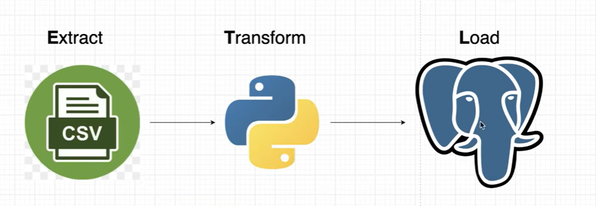

# Overview. 

The folder currently contains multiple learning projects, but the particular focus is an EMF Camp data engineering project.

The most relevant code for feedback and potential rework is currently in the `.ipynb` notebooks under `src`.

The notebooks are currently numbered in their intended order of execution, as they cover both data exploration and the collection of source data. I intend to refactor these at a later stage.

The primary focus at present is `etl_talks`, which aims to prepare and combine the event schedule data with the derived transcription data from the public talks.

Additional weather data from MQTT to come soon.

## Currently Intended Architecture. 

[Notes](Assets/EMFCamp%20Notes/MQTT%20notes.md)  
[Learning source1](https://www.youtube.com/watch?v=G0crKzK9Ayk)

# Other potentially useful titbits.  
[MQTT Visualiser](https://ryanbateman.github.io/mqtt_vis/?broker=wss%3A%2F%2Fmqtt.emf.camp%3A15676%2Fws&topic=%23)
